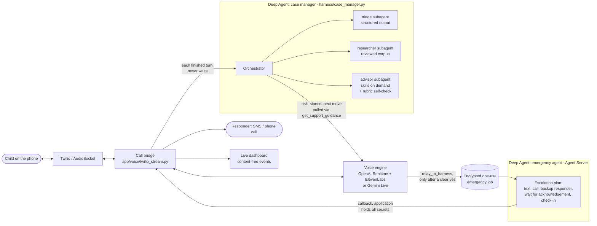

# Ayo 📞

**Ayo** is a listening friend for children on the phone, by Education for Equality. This repo is built on the Sabi Safe telephony stack. Set `VOICE_ENGINE=openai` for Ayo's voice (OpenAI Realtime hears and thinks, ElevenLabs Bukola speaks); see `docs/AYO_INTEGRATION.md`. Ayo's real prompt is private: set `AYO_PROMPT_PATH`.

A clean, modular rebuild of the **Sabi full-duplex telephony voice stack**, purpose-built for **trauma-informed youth support, emotional grounding, and crisis triage**.

This repository contains the full production telephony architecture of Sabi—free of educational curricula—paired with clinical psychological principles (Psychological First Aid, NICHD Child Forensic Interview Protocol) and low-latency bidirectional voice AI.

## 🎯 Who it is for and why

**Target user:** a child or teenager, often with only a basic phone and no internet, who is scared, hurt or unsure who to tell. They call a free number and talk to a calm voice. **Second user:** the emergency responder or safeguarding contact who is brought in, with the child's agreement, when the child needs help beyond the call.

**The problem:** children in danger rarely write to a chatbot; they call, and many never reach anyone. A voice agent must answer at once, stay gentle, never interrogate or promise secrecy, and still be able to get a human involved honestly.

**How it works, in short:** a fast voice agent talks to the child and never waits on slower reasoning. In the background, Deep Agents do the careful work: a case manager advises on every turn, and an emergency agent plans and runs the escalation once the child agrees.

### Architecture



| Deep Agents feature | Where it is used |
|---|---|
| Subagents | Case manager (`triage`, `researcher`, `advisor`); emergency agent as an async subagent on the Agent Server |
| Skills, loaded on demand | Empathy and CBT skills in `harness/skills/`, read-only route into the advisor |
| Structured output | `Triage` and `Advice` schemas |
| Rubric self-check | Advice is graded against a safety rubric and revised until it passes (`AdviceRubric`) |
| Planning and async tasks | Emergency escalation ladder with check-ins and an acknowledgement window |
| Studio and tracing | `case_manager` and `emergency` graphs in `langgraph.json`; synthetic-call tracing only |

> Not yet connected: the live-call guardrail helpers in `app/safety/guardrails.py`, and inbound SMS replies (acknowledgements and location) reaching a running escalation.

---

## ⚡ Key Capabilities

- 📞 **Dual-Protocol Telephony Support:**
  - **Twilio Media Streams** (`/ws/twilio`): Cloud WebSocket audio streaming over standard phone numbers.
  - **Asterisk AudioSocket** (TCP `9020`): Low-latency native telephony protocol for GSM networks (e.g. Africa's Talking).
- 🎙️ **Full-Duplex Gemini Live Streaming:** Real-time conversational voice via Google Gemini Live API with instant barge-in / interruption handling.
- 🎛️ **Fast Audio Codec & Resampling:** In-memory G.711 $\mu$-law encoder/decoder and stateful 3:1 decimator (24 kHz $\rightarrow$ 8 kHz) with zero external C dependencies.
- 🧠 **Trauma-Informed Voice Prompting:** Rooted in Bruce Perry's Neurosequential Model (*Regulate $\rightarrow$ Relate $\rightarrow$ Reason*), open invitations, and de-blaming.
- 🛡️ **Defense-in-Depth Guardrails:** Hard short-circuiting for abuse disclosures, self-harm, and immediate physical peril, routing to verified Nigerian (112, Cece Yara 0800 800 8001) and international (988) emergency services.
- 🚫 **No False Secrecy:** Transparent, compassionate boundary setting that protects youth without mimicking predatory secrecy.

---

## 🚀 Quick Start

### 1. Installation

```bash
git clone <repo-url>
cd sabi-safe

# Create virtual environment
python3 -m venv .venv
source .venv/bin/activate

# Install dependencies
pip install -r requirements.txt
```

### 2. Environment Variables

Create `.env` based on `.env.example`:

```bash
cp .env.example .env
```

Set your `GEMINI_API_KEY`:
```ini
GEMINI_API_KEY="your-gemini-api-key"
GEMINI_VOICE="Puck"
# Optional: which Live speech model to run. Point it at another Live
# model, e.g. "models/gemini-3.8-live"; the models/ prefix is optional.
GEMINI_LIVE_MODEL="gemini-3.1-flash-live-preview"
```

### 3. Run the Server

```bash
# Start FastAPI and the background AudioSocket server
uvicorn app.main:app --host 0.0.0.0 --port 8000 --reload
```

For the local Compose setup, set `GEMINI_API_KEY` and `TWILIO_AUTH_TOKEN` in
`.env`, then run `docker compose --profile dev up --build`. This starts the app
and a Postgres container with a persistent development volume. For a local
non-Compose server, set `DATABASE_URL` to a PostgreSQL connection string.

The Twilio webhook validates the request signature and passes a short-lived signed caller number to the media stream. When the stream starts, the application plays Ayo's recorded greeting (if `AYO_GREETING_AUDIO` is set) while it collects the caller's first moments of speech (up to 12 seconds). It then runs a deterministic voice check, with no language model in the path: the first call enrols the number's voice, later calls compare against it. The result is one of four identity states: `known`, `new`, `unknown` or `unsure`. Only after that does the voice engine connect, and the caller's first words are replayed to it so Ayo answers them. A mismatch, too little speech, a missing identity or a verification error never ends the call: `unsure` or `unknown` only means saved preferences are not loaded or written for that call (a voice-matched returning caller gets their consented memory back). AudioSocket calls do not carry the persistent caller number, so they have no voice recognition.

`VOICE_VERIFICATION_THRESHOLD` defaults to 0.75 for demonstration only; it
must be calibrated on representative telephone recordings before relying on
matches. Phone numbers and voice embeddings are stored in Postgres and a phone
number or voice match is not proof of identity. The development database uses
local-only example credentials and is not a production data protection setup.
The first call creates an enrollment without independently proving identity.

The Deep Agents harness bundles the Empathy and CBT skills under
`harness/skills/`. The background case manager (below) reads them on demand, so
they shape the guidance the caller-facing voice agent receives; Gemini Live
itself does not load them.

Emergency SMS uses Photon 2.0 (`harness/tools/photon_sms.py`). Set `PHOTON_API_KEY`, `PHOTON_PROJECT_ID`,
`PHOTON_RESOURCE_ID` (the `pho_res_...` ID of your purchased SMS number; the sender user is resolved from it
automatically, or set `PHOTON_SENDER_ID` to skip the lookup), and
`EMERGENCY_RESPONDER_NUMBER` (E.164); optionally `EMERGENCY_BACKUP_RESPONDER_NUMBER`, a second responder the emergency agent texts if neither channel to the first was accepted (see `docs/ASYNC_EMERGENCY_AGENT.md`, "Escalation plan"). A responder text or call requires the caller's
clear agreement to the agent's permission question. The location request texts
the caller, but inbound SMS replies are not processed. Photon acceptance is not
proof of delivery. The `start_phone_call` tool (`harness/tools/start_phone_call.py`) places an outbound Twilio call to `EMERGENCY_RESPONDER_NUMBER` that reads the caller-approved message twice; it needs `TWILIO_ACCOUNT_SID`, `TWILIO_AUTH_TOKEN` and `TWILIO_PHONE_NUMBER`, and a result of `submitted` means Twilio accepted the request, not that anyone answered. Texting or calling the responder both require the caller's agreement to the same question. The consent check is
conservative and depends on speech transcription; unclear answers require the
caller to repeat their agreement. Confirm that the configured recipient can
actually receive and act on SMS before relying on this integration.

---

## 🔭 Seeing the agents work

Three ways to watch the case manager and the emergency agent, none of which expose what a child said.

**Live case view.** Set `DASHBOARD_TOKEN` (24+ random characters) and open `/dashboard`; paste the token when asked. For each call it shows the risk timeline (one block per case-manager cycle), the case plan (which specialists ran, the safety rubric result, and the emergency ladder: text the responder, phone the responder, text the backup responder, ask the caller for location), consent to contact the responder, and whether the responder has acknowledged. It is built from the content-free tool events (`harness/tool_log.py`) through a fixed list of fields (`harness/dashboard.py`), shows calls by a short hash of the call SID, and is off (404) until the token is set. Events are held in that process's memory, so run one app worker, and serve it over TLS. A responder acknowledgement appears only once something posts one (`post_job_event`); nothing in the app does that yet, so it reads "No acknowledgement yet".

**LangGraph Studio.** `langgraph.json` registers the case manager as the `case_manager` graph next to `emergency`. Run `langgraph dev` with `GEMINI_API_KEY` and `AGENT_SERVER_AUTH_SECRET` set (the existing bearer auth in `langgraph.json` applies to API calls to the dev server). Give it a transcript such as `{"transcript": "Child: I can't sleep\nAssistant: I am here.", "profile": {}}` and watch the orchestrator delegate to the triage, researcher and advisor specialists and the rubric grade the advice. Use made-up text only. It is the same agent a live call runs and is not part of the production Agent Server image.

**One traced synthetic call.** `python -m scripts.trace_synthetic_call` (needs `GEMINI_API_KEY` and `LANGSMITH_API_KEY`) runs an invented conversation through the case manager with LangSmith tracing on and sends the trace to `LANGSMITH_PROJECT`, tagged `synthetic`. It accepts no other input. Real calls are never traced: the application switches LangSmith tracing off at startup whatever the environment says, and the case manager traces only when it is given trace settings, which only that script does (`harness/tracing.py`).

---

## 🧪 Running Tests

```bash
pytest tests
```

Expected: all tests pass (about 225 passed, 16 skipped at the time of writing). If your `.env` sets `TWILIO_AUTH_TOKEN`, the five webhook tests in `tests/test_caller_location.py` return 403 because signature checking is on; run them with `TWILIO_AUTH_TOKEN= pytest tests`.

---

## 📖 Documentation

- [Telephony Architecture & Protocol Reference](docs/ARCHITECTURE.md)
- [Trauma-Informed Voice Care (PFA & Neurosequential Model)](docs/psychology/TRAUMA_INFORMED_CARE.md)
- [NICHD Protocol & Child Safeguarding Standards](docs/psychology/NICHD_PROTOCOL_GUIDE.md)

---

## 📄 License
MIT License

### Child-support knowledge and memory (review required)

The optional Twilio support harness runs a background coordinator (`harness/coordinator.py`). After every turn the bridge hands it the transcript without waiting. The coordinator runs a per-call Deep Agents **case manager** (`harness/case_manager.py`): an orchestrator reads the call so far and runs only the specialists worth running this cycle. The `advisor` runs every cycle: it rates risk and writes next-reply guidance, loading the bundled Empathy and CBT skills on demand from `harness/skills/` through a read-only route; its answer is graded against a safety rubric (no why-questions, no secrecy promises, no contact without a clear yes, no claim that help is coming, short plain sentences, safety first when urgent) and revised until it passes, and a deterministic filter then drops any line that still breaks a hard rule. `triage` (topics and communication preferences) runs only when the conversation has moved on: the first cycle, a new concern, or a stated preference. The `researcher` (reviewed corpus excerpts, by topic only; skipped unless `DATABASE_URL` and `COHERE_API_KEY` are set) runs only for topics not researched yet. Topics, notes and sources carry over between cycles, so a cycle that runs only the advisor still returns the full picture. The coordinator publishes risk, stance, do, avoid, next move, source references and the rubric outcome. Gemini pulls the newest guidance with `get_support_guidance`, which returns instantly with `turns_behind` and `stale` flags, so the case manager never slows the call. A typical cycle makes about 4 to 6 model calls, and one that runs triage and research about 10 (see `COORDINATOR_MIN_INTERVAL_SECONDS`). Retrieval uses only a fixed set of topic queries; caller words are not sent to Cohere (they are sent to Gemini, as in the call itself). Use `COORDINATOR_MODEL` to pick its model and `COORDINATOR_FALLBACK_MODELS` for fallbacks. The corpus is declared in `harness/corpus/sources.json` (Markdown file plus metadata). On each start the sync computes a content digest per source, combined with the chunking/embedding pipeline signature, and compares it with the stored one: unchanged sources are skipped with no chunking or Cohere calls; changed ones are re-chunked and re-embedded in one transaction. Sources ship `review_status: pending` and `rights_verified: false`, so nothing is ingested until a person reviews the licence and clinical content and flips both fields; setting a source back to pending withdraws it from retrieval on the next start. Syncing is best-effort (a Cohere outage is logged and does not block startup; use `--strict` to fail instead). `python -m harness.corpus.ingest --draft-from-md <md> out.json` drafts a manifest entry from a Markdown file.

1. Use a PostgreSQL instance with pgvector installed; the `dev` Compose database uses `pgvector/pgvector:pg17`. Set `DATABASE_URL`. With Docker Compose, the `support-init` service runs before the backend on every start: it applies `migrations/001_support_rag.sql` (idempotent, must succeed) and then syncs corpus chunks (`python -m scripts.sync_support`; outside Compose run the same command with `DATABASE_URL` set, or `python scripts/migrate_support.py` for the schema only).
2. `harness/corpus/sources.pending.json` lists candidate sources and draft paraphrases, not an approved corpus. Have an appropriate child-safeguarding specialist review source text, page references, suitability, and reuse rights. Replace the draft sections with reviewed text and set each source's `review_status` to `approved` and `rights_verified` to `true` only after that review. The WHO handbook's license is noncommercial and share-alike. Ingest the reviewed JSON with `python -m harness.corpus.ingest path/to/reviewed.json`. The command embeds text through Cohere and requires `COHERE_API_KEY`.
3. After clinical, identity, and provider-data reviews, set `SUPPORT_GUIDANCE_ENABLED=true` and/or `SUPPORT_MEMORY_ENABLED=true`. Both default to false. Memory requires `SUPPORT_MEMORY_ENCRYPTION_KEY` (a Fernet key) and a separate random `SUPPORT_MEMORY_IDENTITY_KEY`; protect both outside the database. Generate a Fernet key with `python -c 'from cryptography.fernet import Fernet; print(Fernet.generate_key().decode())'`. Set `SUPPORT_MEMORY_RETENTION_DAYS` from 1 to 365 (default 30).

Memory is built as the call progresses: the coordinator proposes updates and they are held in RAM, then saved (encrypted) only once the caller agrees to memory, and re-saved as more is learned. It stores only a fixed vocabulary: speaking pace, breathing preference, and helpful/avoided approaches (`harness/support.py`). It does not summarize abuse or record free-form history. Consent and deletion recognition are intentionally narrow; verify the call experience with safeguarding specialists before enabling. Expired memory is purged at the next memory-enabled call; schedule `SupportMemoryStore.purge_expired()` separately if deletion must occur without later calls. Audit entries contain only an HMAC caller key, action, and timestamp; set an organizational audit retention policy. Back up and rotate encryption and identity keys under an operational key-management procedure; losing or changing them without a migration makes existing memory inaccessible.

The token-aware splitter downloads the `cl100k_base` tokenizer data on first use; pre-cache it in offline deployments. The semantic chunker is supplied by the archived `langchain-experimental` package; keep it isolated to offline ingestion and review its dependency security before deployment.
