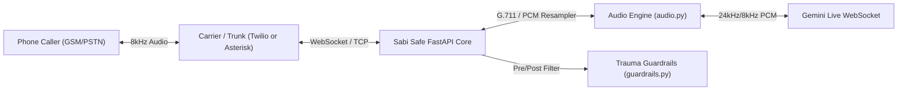

# Sabi Safe — Telephony Architecture & Engineering Reference

## 1. System Overview

Sabi Safe is a clean, non-curricular voice telephony platform derived from the Sabi production stack. It enables full-duplex, low-latency conversational voice interactions over regular telephone lines (GSM/PSTN) and VoIP channels. Instead of academic curricula (maths, literacy), Sabi Safe implements a trauma-informed emotional grounding and crisis triage architecture.



---

## 2. Telephony Protocols Supported

### Channel A: Twilio Media Streams (WebSocket G.711 mu-law 8kHz)
- **Use Case:** Hackathons, cloud deployments, instant toll-free / local phone numbers without PBX infrastructure.
- **Protocol:** Bidirectional WebSocket over HTTPS.
- **Payload:** Base64-encoded G.711 $\mu$-law chunks (typically 20 ms / 160 bytes).
- **Interruption Handling:** Emits `{"event": "clear", "streamSid": "..."}` to immediately dump Twilio's audio playback queue upon user barge-in.

### Channel B: Asterisk AudioSocket (TCP slin16 8kHz mono)
- **Use Case:** Production GSM telephony via Africa's Talking, SIP trunking, local PBX routing in Nigeria.
- **Protocol:** Pure binary TCP protocol on port `9020`.
- **Packet Structure:** 3-byte header `[type (1 byte), length (2 bytes uint16)]` followed by payload:
  - `0x01`: Audio chunk (typically 20 ms / 320 bytes PCM16 at 8 kHz).
  - `0x10`: 16-byte Call UUID.
  - `0x00`: Hangup notification.
  - `0x02`: Silence.

---

## 3. Audio Codec & Realtime Resampling Engine (`app/voice/audio.py`)

Telephony requires 8 kHz sample rate; Gemini Live produces 24 kHz audio. 

1. **G.711 $\mu$-Law Table Companding:** Precomputed 65,536-entry integer lookup tables for $\mu$-law encode/decode execute in nanoseconds without C library overhead (`audioop` or `numpy`).
2. **Stateful Decimator (`Downsample24kTo8k`):**
   - Applies an integer 3-sample moving average filter to suppress high-frequency aliasing.
   - Retains leftover sample remainders across WebSocket packet boundaries to prevent phase distortion and clicking artifacts.
3. **Frame Chunker (`FrameChunker`):**
   - Re-packetizes variable-sized Gemini audio buffers into exact 20 ms telephony frames (160 bytes for $\mu$-law, 320 bytes for 8 kHz PCM16).

---

## 4. Full-Duplex Gemini Live Bridge (`app/voice/gemini_live.py`)

- Connects to Google's Bidirectional Streaming API endpoint:
  `wss://generativelanguage.googleapis.com/ws/google.ai.generativelanguage.v1alpha.GenerativeService.BidiGenerateContent`
- Initiates session with `setup` payload configuring `gemini-3.1-flash-live-preview` (or `gemini-2.5-flash`), custom trauma-informed system prompt, and selected voice model.
- Listens concurrently for `serverContent` audio packets and `serverContent.interrupted` signals, instantly cancelling stale playback.

---

## 5. Directory Structure

```
sabi-safe/
├── app/
│   ├── main.py                  # FastAPI server, Twilio webhook, lifespan manager
│   ├── prompts/
│   │   └── sabi_safe_prompt.md  # Core trauma-informed voice system prompt
│   ├── safety/
│   │   ├── __init__.py
│   │   └── guardrails.py        # Crisis short-circuits, PII, boundary enforcement
│   └── voice/
│       ├── __init__.py
│       ├── audio.py             # G.711 mu-law codec, 24k->8k resampling, chunker
│       ├── audiosocket.py       # Asterisk TCP AudioSocket server
│       ├── gemini_live.py       # Gemini Live bidirectional WebSocket client
│       └── twilio_stream.py     # Twilio Media Streams bridge
├── docs/
│   ├── ARCHITECTURE.md          # This technical reference
│   └── psychology/
│       ├── NICHD_PROTOCOL_GUIDE.md
│       └── TRAUMA_INFORMED_CARE.md
├── tests/
│   ├── test_api.py              # Health check & webhook tests
│   ├── test_audio.py            # Codec round-trip & resampler tests
│   └── test_guardrails.py       # Safety short-circuit tests
├── Dockerfile                   # Production container definition
├── docker-compose.yml           # Multi-service container orchestration
├── pytest.ini                   # Pytest path configuration
└── requirements.txt             # Minimal pinned dependencies
```
