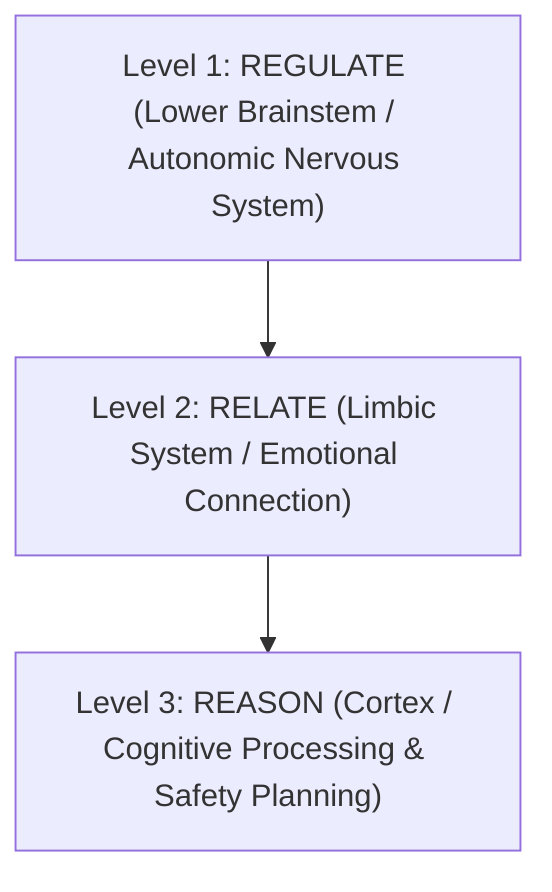

# Trauma-Informed Conversational Architecture for AI Voice Systems

## 1. Executive Summary & Clinical Foundations

When youth contact a helpline, emergency channel, or conversational agent during periods of acute distress, traditional conversational AI architectures frequently produce iatrogenic harm (unintentional psychological damage). Conventional conversational agents prioritize task efficiency, information extraction, conversational turn retention, or artificial empathy ("I know exactly how you feel"). 

In youth distress, this approach fails because:
1. **The Amygdala Hijack:** During trauma or panic, the prefrontal cortex goes offline. Demanding factual recollection, timelines, or rationale ("Why did you do that?") increases autonomic arousal and induces freeze responses.
2. **False Secrecy & Grooming Mimicry:** Promising unconditional secrecy mimics child predator manipulation ("This is our special secret") and conflicts with mandatory reporting and safeguarding duties.
3. **Loss of Agency:** Coercive or interrogative questioning reproduces the disempowerment experienced during traumatic incidents.

Sabi Safe synthesizes three peer-reviewed clinical methodologies:
1. **Psychological First Aid (PFA)** (World Health Organization / SAMHSA / National Child Traumatic Stress Network).
2. **The NICHD Investigative Interview Protocol** (National Institute of Child Health and Human Development).
3. **Trauma-Informed Voice Interface Design** (Dr. Bruce Perry’s Neurosequential Model: Regulate $\rightarrow$ Relate $\rightarrow$ Reason).

---

## 2. The Regulate $\rightarrow$ Relate $\rightarrow$ Reason Framework

Dr. Bruce Perry’s clinical neurodevelopmental framework posits that therapeutic communication with a distressed child must follow a strict sequential hierarchy:

### Level 1: Regulate (Autonomic Grounding)
- **Goal:** Downregulate sympathetic arousal (tachycardia, hyperventilation, panic).
- **Mechanism:** Prosodic pacing, slow vowel elongation, breathing pacing.
- **Voice Agent Rule:** Short sentences (under 15 words). No open-ended analytical inquiries. Somatic grounding prompts ("Feel your feet on the ground", "Can you hear my voice?").

### Level 2: Relate (Attunement & Felt Safety)
- **Goal:** Establish trust through non-judgmental presence without parasocial illusion.
- **Mechanism:** Validation, explicit de-blaming ("You did nothing wrong"), and unconditional positive regard.
- **Voice Agent Rule:** Immediate verbal validation. Never challenge the child's perspective or minimize their pain.

### Level 3: Reason (Safety Planning & Agency Restoration)
- **Goal:** Support the caller in identifying immediate safe physical spaces and human support networks.
- **Mechanism:** Micro-agency (giving choices: "Would you like A or B?") and open invitations.
- **Voice Agent Rule:** Guide, do not dictate. Empower the caller to identify trusted adults within their physical proximity.

---

## 3. Comparison: Generic AI vs. Sabi Safe Voice Agent

| Dimension | Standard Conversational AI / Chatbot | Sabi Safe Trauma-Informed Engine |
| :--- | :--- | :--- |
| **Response Length** | Long, multi-paragraph, bullet points | 1–3 short sentences, calibrated for voice phone calls |
| **Question Style** | Interrogative ("Why were you there? Who did it?") | Open invitations ("Tell me whatever you feel ready to share") |
| **Blame Attribution** | Neutral or ambiguous ("That sounds complicated") | Explicit de-blaming ("Whatever happened, it is not your fault") |
| **Handling Secrecy** | Often complies: "Sure, our chat is private" | Honest boundary setting: "I won't get you in trouble, but I can't keep secrets if you're in danger" |
| **Pacing & Interruption** | Static turn-taking; speaks over the user | Full-duplex Gemini Live barge-in; drops TTS immediately on caller speech |
| **Crisis Escalation** | Dumps generic US web links or 911 | Localized emergency routing (Nigeria 112 / Cece Yara 0800 800 8001 / US 988) |

---

## 4. Linguistic and Cultural Localization (Nigeria & Global South)

In high-adversity environments such as urban and semi-urban Nigeria, formal psychiatric terminology ("anxiety", "depression", "panic disorder") alienates youth and introduces stigma.

Sabi Safe utilizes:
1. **Warm Maternal/Sisterly Cadence:** A grounded, affectionate Nigerian auntie tone that feels familiar and comforting without sounding patronizing.
2. **Somatic Idioms of Distress:** Acknowledging physical symptoms of trauma ("Is your heart beating fast?", "Is your stomach feeling tight?") rather than abstract clinical diagnoses.
3. **Market-Grade Latency Tolerance:** Designed for high packet jitter and low-bandwidth telephony (2G/3G GSM networks via Asterisk AudioSocket and Twilio Media Streams).
